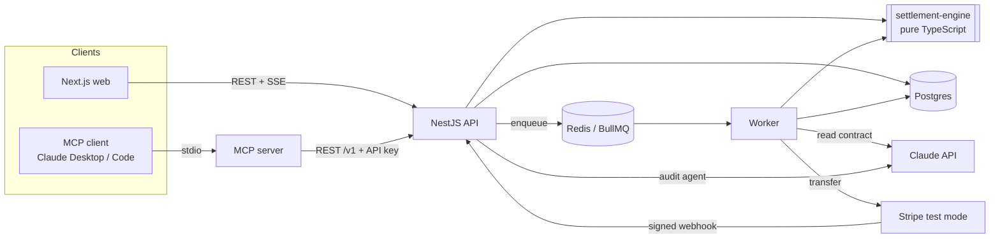

# Ledgerline

[](https://github.com/korayUrun/ledgerline/actions/workflows/ci.yml)

Ledgerline turns an artist contract (PDF), ticket sales and show expenses into a correct,
explainable artist payout, then pays it through Stripe (test mode). **The AI reads and
explains, the code calculates, a person approves.** Synthetic data only.

Docs: [project overview](docs/PROJECT_OVERVIEW.md) · [features](docs/FEATURES.md) ·
[architecture](docs/SYSTEM.md) · [build phases](docs/PHASES.md)

## The problem

After a concert the venue owes the artist money, and the amount depends on the deal in the
contract: a flat guarantee, a percentage of net receipts, the greater of the two, or a
guarantee plus a split above a break-even point, with bonus tiers and caps on which expenses
count. Today this "settlement" is a spreadsheet filled in late at night from a PDF, and a
wrong cell is real money, paid once and hard to take back.

Ledgerline splits the job by what each part is good at:

| Step | Who | Feature |
|---|---|---|
| Import ticket sales and expenses | person | F1 |
| Read the contract into structured deal terms, each with the sentence it came from | Claude | F2 |
| Check and confirm the terms | person | F3 |
| Compute the payout as itemized lines (integer cents, pure function) | code | F4, F5 |
| Audit the settlement, flag suspicious expenses, explain any number | Claude (agent with tools) | F6 |
| Approve | person only | F7 |
| Pay exactly once, confirmed by a signed webhook | background job + Stripe | F7, F8 |
| Read settlements from other tools: REST API and an MCP server | API key | F9, F10 |

Evals (F11) measure the AI steps against generated ground truth; audit logs, agent traces and
structured logs (F12) explain afterwards what happened.

## Architecture



A pnpm + Turborepo monorepo, TypeScript (strict) everywhere:

```
apps/web                     Next.js UI (talks to the API over HTTP only)
apps/api                     NestJS: main.ts (HTTP) and worker.ts (BullMQ jobs), one codebase
apps/mcp                     MCP server, a thin client of the /v1 API
packages/settlement-engine   the money math: no I/O, no clock, no randomness
packages/schemas             Zod schemas shared by every app
packages/db                  Prisma schema, migrations, seed
packages/evals               eval dataset generator and runners
```

## Key decisions

Each one is explained in [`docs/SYSTEM.md`](docs/SYSTEM.md); the link goes to the section.

- **Money is integer cents, percentages are basis points** (8500 = 85%). No floats where money
  flows; rounding happens in one helper of the engine, and a lint rule bans `toFixed` /
  `parseFloat` in the apps. → [§6](docs/SYSTEM.md#6-settlement-engine-f4)
- **The engine is a pure function** of a frozen input snapshot. A settlement stores its
  inputs, their hash and the engine version, so any payout can be recomputed and explained
  line by line, years later. → [§6](docs/SYSTEM.md#6-settlement-engine-f4)
- **LLM output is untrusted.** Extraction uses structured output, is validated with Zod
  (retry on failure), cites the sentence behind every field, and a person confirms it before
  anything is computed. Contract text is treated as possible prompt injection.
  → [§7.1](docs/SYSTEM.md#71-contract-extraction-f2)
- **The agent loop is written by hand** (no framework): `stop_reason`, `tool_use` /
  `tool_result`, a step limit and a token budget, every step saved for replay. The agent never
  adds numbers; it calls `recompute_settlement`. It has no approve or pay tool.
  → [§7.2](docs/SYSTEM.md#72-audit-agent-f6-hand-written-loop)
- **Exactly-once payment:** status changes go through a state machine with the audit log in
  the same transaction; every Stripe call carries the payout's idempotency key; the webhook is
  the source of truth, signature-checked and deduplicated by event id; a sweeper re-enqueues
  stuck payouts. Four failure drills (killed worker, duplicate webhook, double click, bad
  signature) pass in tests and against a real Stripe sandbox. → [§8](docs/SYSTEM.md#8-payments-f7)
- **API and worker are two entry points of one NestJS app**, so a slow Claude call never
  blocks an HTTP request and an API restart never kills a payout.
  → [§9](docs/SYSTEM.md#9-background-jobs-f8)
- **The MCP server has no database access.** It calls the public `/v1` API with a hashed,
  revocable, rate-limited API key, so rules live in one place.
  → [§10](docs/SYSTEM.md#10-public-api-f9--mcp-server-f10)
- **Evals with free, exact labels:** contracts are generated as PDFs from random ground-truth
  terms, so every field and every payout has a known answer; an `--oracle` mode proves the
  pipeline itself scores 100%. → [§11](docs/SYSTEM.md#11-evals-f11)
- **Structured logs** (pino, JSON) carry `requestId`, `jobId` and `settlementId` on every line
  through `AsyncLocalStorage`, so one grep tells the story of one payout.
  → [§12](docs/SYSTEM.md#12-observability-f12)

## Eval results

Contract extraction, 25 generated contracts (`packages/evals/baselines/extraction.md`):

| Metric | Result |
|---|---|
| Field accuracy (12 fields × 25 contracts) | **100%** (300/300) |
| Payout exact to the cent (extracted terms → engine) | **100%** (25/25) |
| Extraction failures / retries | 0 / 0 |
| Cost per contract | $0.042 |
| Time per contract | 5.8 s |

Model `claude-opus-5-5`, prompt `extract-v2`, 2026-11-19. PRs that touch the prompt, the LLM
client, the schemas or the evals rerun this live and fail below these numbers
([`evals.yml`](.github/workflows/evals.yml)). Hard cases are tagged in the
dataset: money written in words, cents in the guarantee, sub-clauses, a merch percentage and
a deposit that are not deal terms, and two contracts with a prompt-injection line.

Audit agent, the same 25 shows with planted expense violations
(`packages/evals/baselines/agent.md`):

| Metric | Result |
|---|---|
| Precision (flagged expenses that are real violations) | **100%** (26/26) |
| Recall (planted violations found) | **100%** (26/26) |
| Right kind of flag | 26/26 |
| Cost per audit | $0.0018 |
| Time per audit | 10.1 s |

Model `claude-haiku-5-5` (the default `AGENT_MODEL`), prompt `agent-v1`, 2026-11-24. Both
datasets are now too easy to tell a good prompt or model from a better one; harder cases are on
the Later list.

## Run it locally

Needs Node 24 (`.nvmrc`), pnpm (`corepack enable` picks the version pinned in
`package.json`) and Docker.

```bash
git clone https://github.com/korayUrun/ledgerline.git && cd ledgerline
cp .env.example .env          # works as is with LLM_CLIENT=fake below
docker compose up -d          # Postgres and Redis, on 127.0.0.1 only
pnpm install
pnpm run prepare              # git hook that blocks committed API keys
pnpm db:migrate               # create the tables
pnpm db:seed                  # demo user and three shows (empties the database first)
LLM_CLIENT=fake pnpm dev      # web :3000, API :3001, worker
```

Open http://localhost:3000 and log in as `demo@ledgerline.test` / `ledgerline-demo`.

- `LLM_CLIENT=fake` runs everything without an Anthropic key: an uploaded contract comes back
  empty (you type the terms on the review screen) and the assistant says it is offline. Put
  `ANTHROPIC_API_KEY` in `.env` and drop the prefix to use Claude.
- Approving and paying need `STRIPE_SECRET_KEY` (an `sk_test_` key) and
  `STRIPE_WEBHOOK_SECRET` in `.env`, and `stripe listen --forward-to
  localhost:3001/payments/webhook`; without them the rest of the app works and approval says
  payments are not configured. See [§8 "Live run"](docs/SYSTEM.md#8-payments-f7).
- Port 3001 taken? `API_PORT=3002 API_URL=http://localhost:3002 pnpm dev`.
- Logs are one JSON object per line; `LOG_FORMAT=pretty` prints them as text, `LOG_LEVEL=debug`
  shows more.

Checks:

```bash
pnpm test                     # unit + integration (integration tests start Postgres with Docker)
pnpm lint && pnpm typecheck
pnpm evals --oracle           # eval pipeline without API calls: must score 100%
pnpm evals                    # live extraction eval (needs ANTHROPIC_API_KEY, about $1)
```

## Connect the MCP server (Claude Desktop, Claude Code)

`apps/mcp` is an MCP server with four tools, each a thin wrapper over one route of the
public `/v1` API. It reads settlements and explains them; it cannot approve or pay.

| Tool | API route | What it is for |
|---|---|---|
| `list_shows` | `GET /v1/shows` | find a show and its settlement id |
| `get_settlement` | `GET /v1/settlements/:id` | the worksheet lines down to the payout |
| `explain_settlement_line` | `GET /v1/settlements/:id/lines/:position` | the ticket tiers, expenses and contract clause behind one line |
| `flag_expense` | `POST /v1/expenses/:id/flags` | a note on an expense for a person to review |

### 1. Run the API and create a key

```bash
docker compose up -d
pnpm dev                      # web on :3000, API on :3001 (API_PORT to change it)
```

Log in to the web app, open **API keys**, create a key and copy it. It is shown once.

### 2. Find the two absolute paths

MCP clients start the server themselves, without your shell's `PATH` (nvm included), so
use absolute paths:

```bash
which node                                              # e.g. /Users/you/.nvm/versions/node/v24.12.0/bin/node
echo "$PWD/apps/mcp/node_modules/tsx/dist/cli.mjs"      # run from the repo root
echo "$PWD/apps/mcp/src/index.ts"
```

### 3a. Claude Desktop

Settings → Developer → Edit Config (`claude_desktop_config.json`), then restart Claude
Desktop:

```json
{
  "mcpServers": {
    "ledgerline": {
      "command": "/absolute/path/to/node",
      "args": [
        "/absolute/path/to/ledgerline/apps/mcp/node_modules/tsx/dist/cli.mjs",
        "/absolute/path/to/ledgerline/apps/mcp/src/index.ts"
      ],
      "env": {
        "LEDGERLINE_API_URL": "http://localhost:3001",
        "LEDGERLINE_API_KEY": "ll_…"
      }
    }
  }
}
```

### 3b. Claude Code

```bash
claude mcp add ledgerline \
  -e LEDGERLINE_API_URL=http://localhost:3001 \
  -e LEDGERLINE_API_KEY=ll_… \
  -- /absolute/path/to/node \
     /absolute/path/to/ledgerline/apps/mcp/node_modules/tsx/dist/cli.mjs \
     /absolute/path/to/ledgerline/apps/mcp/src/index.ts
```

Then ask, for example: *"Why did we pay The Velvet Harbors $12,223.65? Go line by line
and cite the contract."*

### Try it without a chat client: MCP Inspector

```bash
npx @modelcontextprotocol/inspector@2.14.0 \
  -e LEDGERLINE_API_URL=http://localhost:3001 -e LEDGERLINE_API_KEY=ll_… \
  "$(which node)" apps/mcp/node_modules/tsx/dist/cli.mjs apps/mcp/src/index.ts
```

This opens a browser UI where you can list the tools and call them. Add `--cli --method
tools/list` (or `--method tools/call --tool-name list_shows`) to stay in the terminal.

### When something is wrong

The server writes its log to stderr (Claude Desktop: Settings → Developer → the server's
log). Tool errors are worded for the model, so the chat usually says what happened:

- *"refused the API key (missing, unknown or revoked)"*: create a new key and update the config.
- *"Could not reach the Ledgerline API"*: the API is not running, or the URL or port is wrong.
- *"answered, but not in the shape of the Ledgerline API"*: `LEDGERLINE_API_URL` points at
  another server.
- *"Rate limit reached"*: wait the number of seconds given (`V1_RATE_LIMIT_PER_MINUTE`).
